# WalletLedger Architecture

GitHub, VS Code and most Markdown viewers render the Mermaid blocks below. For a guided tour of the
code with the file map, read the [project guide](PROJECT_GUIDE.md) first.

## 1. System overview

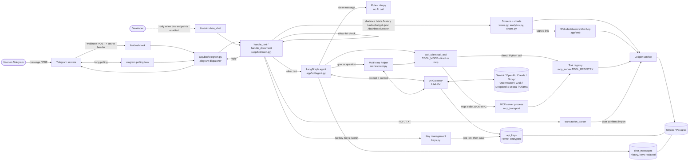

## 2. One chat message, step by step

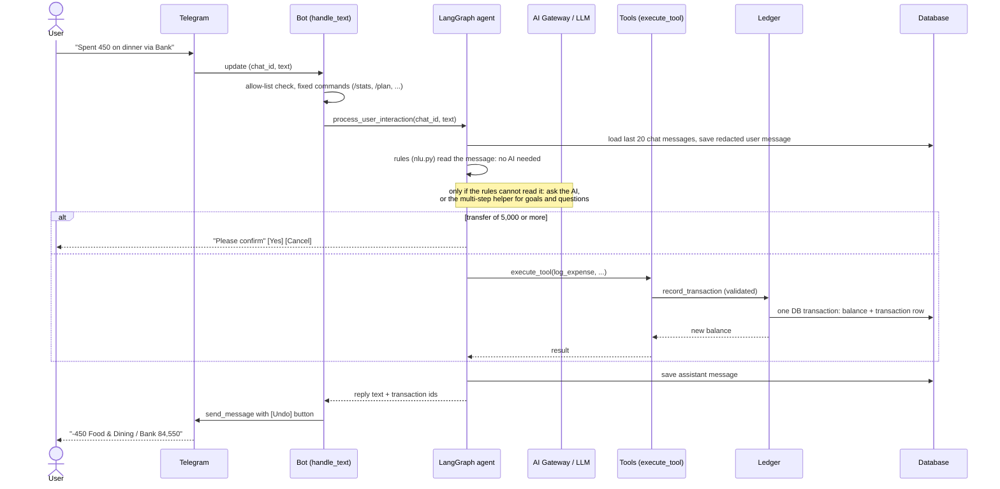

## 3. The agent graph (LangGraph)

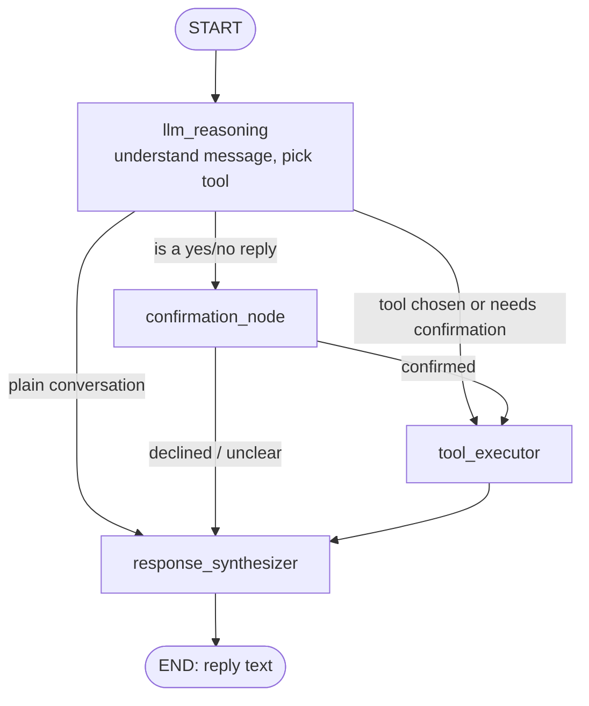

### The multi-step helper (goals and questions)

For "can I afford ...", "how am I doing", "I want to save ...", the AI runs a short loop instead of
a single call. Same tools as everywhere, a few extra guard rails.

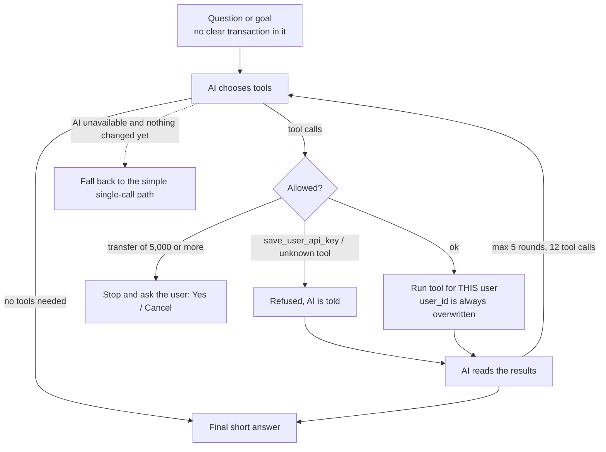

The roles (Ledger records, Analyst looks at real numbers, Planner uses `savings_plan`, Writer answers
briefly) are instructions in one prompt, not separate programs.

## 4. Tank & Pipes money model

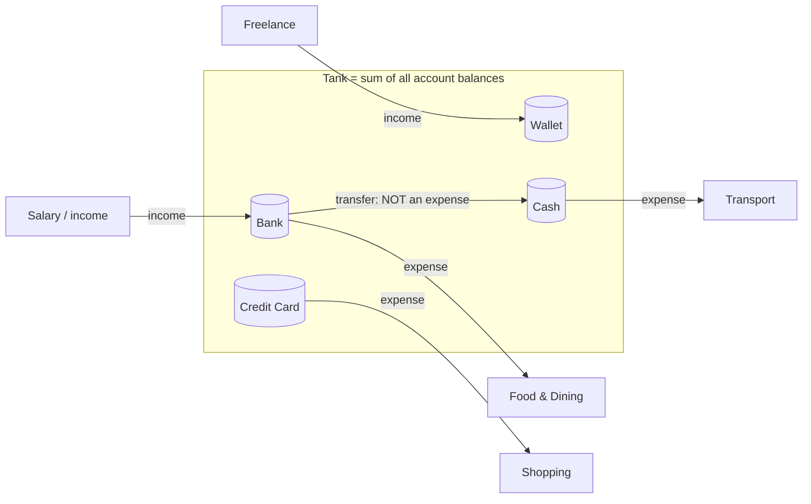

Expense: balance goes down and a category is charged. Income: balance goes up. Transfer: one
account down, another up, nothing counted as spending.

## 5. Data model

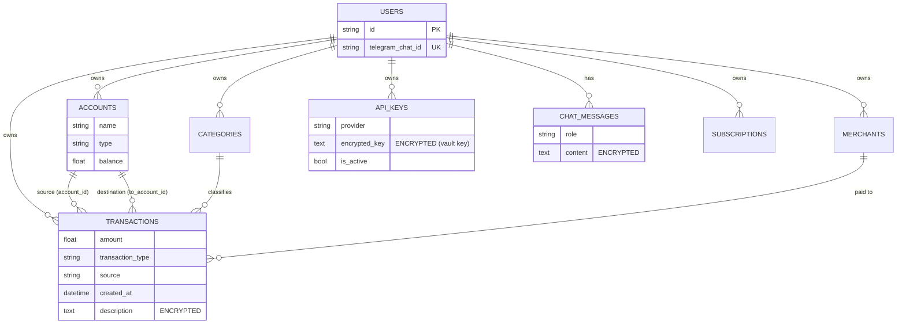

Columns marked ENCRYPTED hold `enc1:...` ciphertext in the file (section 9). Everything else is
readable by the database so it can add up, filter and group.

## 6. Statement import (confirm before saving)

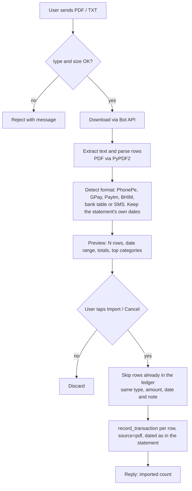

## 7. LLM key rotation and fallback

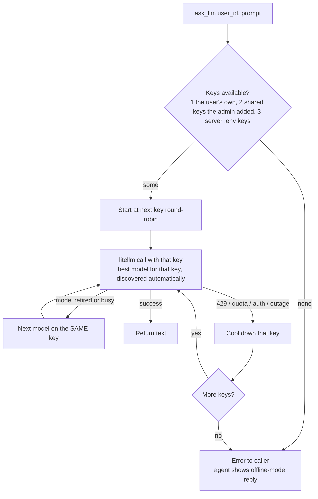

## 8. Deployment modes

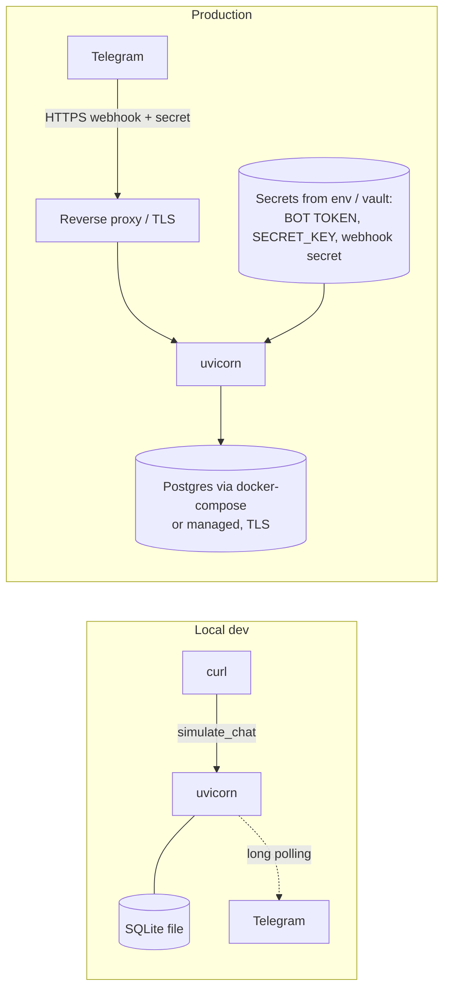

## 9. Data at rest and encryption

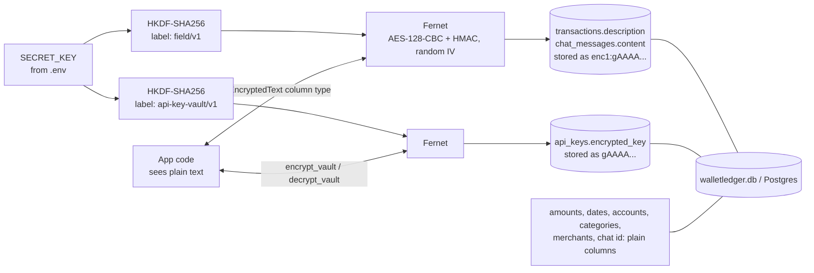

Whoever has the file **and** `SECRET_KEY` can read everything; the file alone shows only ciphertext
and the plain columns. Rotation: put the old secret in `SECRET_KEY_OLD`, run
`scripts/protect_data.py rotate`. Full explanation: [SECURITY.md](SECURITY.md).

## 10. Web dashboard and Mini App sign-in

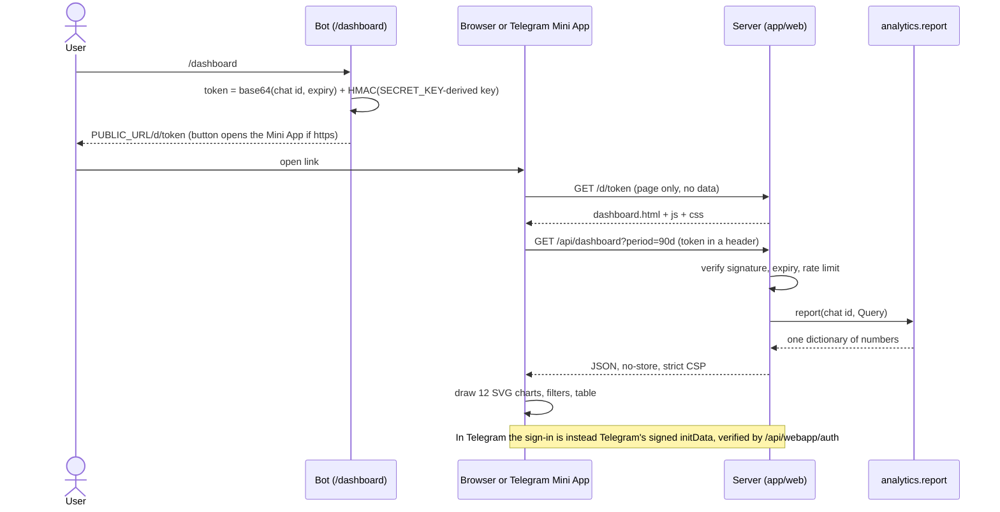

## 11. Button taps

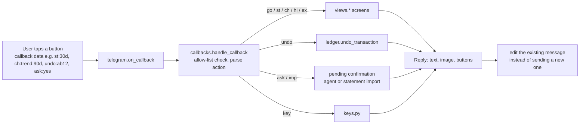

The same map, clickable and generated from the code, is the [explorer](https://fissionlife.github.io/WalletLedger/explore/). Where each box lives in the code, with the reasons behind it, is in the
[project guide](PROJECT_GUIDE.md).
