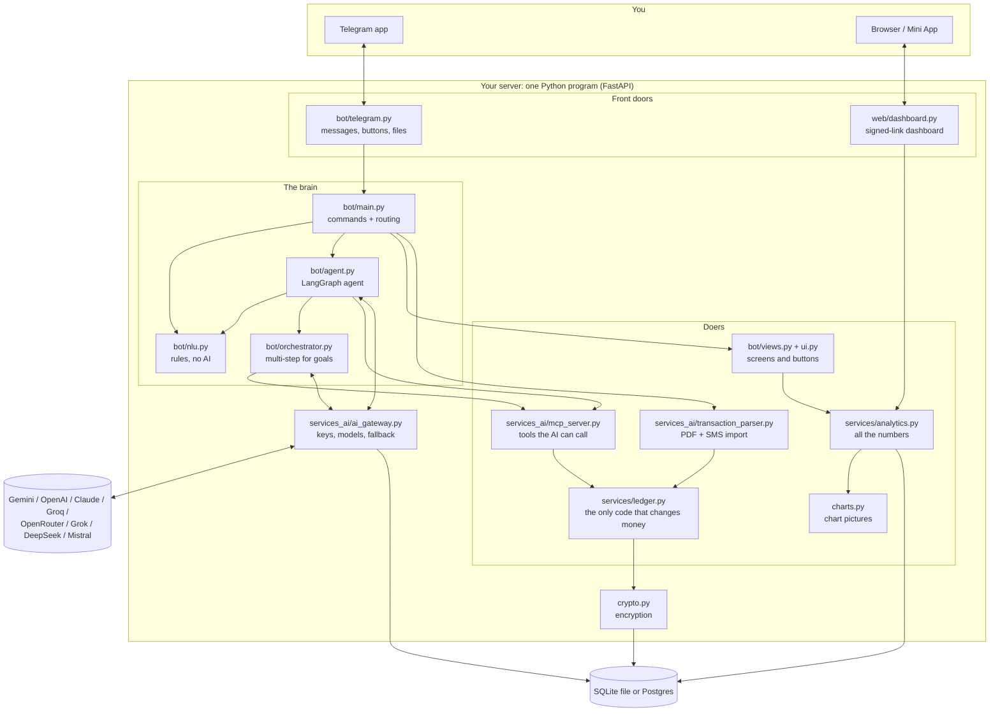

# WalletLedger project guide

The one document that explains **what is where, and how each part works**. Read it top to bottom once;
after that use it as a map. Shorter companions: [HOW_IT_WORKS](HOW_IT_WORKS.md) (5-minute story),
[ARCHITECTURE](ARCHITECTURE.md) (diagrams), [SECURITY](SECURITY.md) (data and encryption),
[DEPLOYMENT](DEPLOYMENT.md), [DEMO](DEMO.md), [DOCUMENTATION](DOCUMENTATION.md) (file table).

---

> **Fastest route in:** the [interactive explorer](https://fissionlife.github.io/WalletLedger/explore/) (guided tours, clickable map, search) or the one-page index [PROJECT_MAP.md](PROJECT_MAP.md). Both are generated from the code and refresh themselves on every push, so they are never out of date (see section 10).

## 1. What it is

WalletLedger is an expense tracker you talk to. It runs as a Telegram bot. You type
*"Spent 450 on dinner via Bank"*; it records it, keeps your account balances, draws charts, opens a web
dashboard, imports bank/UPI PDF statements and plans savings goals. An AI model is **optional**: clear
messages are understood by built-in rules, and the AI (which each user brings a key for) handles
free-form questions.

Money model, "tank and pipes": your **accounts** (Cash, Bank, cards, wallets) are pipes that hold money;
all of them together are your tank. Spending takes money out of an account into a category. Income puts
money in. A **transfer** moves money between your own accounts and is *not* spending.

## 2. The 60-second map



**Three rules hold the design together**

1. **Only `ledger.py` changes balances.** Everything else (chat, AI, PDF import, dashboard) asks it to.
   It validates every amount and changes the balance and the transaction row in one database step.
2. **Rules first, AI second.** If the message is clear, rules handle it instantly and for free. The AI is
   only asked for what rules can't read.
3. **Identity = Telegram chat id.** Every row is tied to the person's chat id; nobody can see another
   chat's data.

## 3. Where everything lives

```
main.py                    start-up: database, Telegram, routes (app/main.py just re-exports it)
app/
  config.py                every setting (read from .env); who is allowed / admin
  db.py, models.py         database connection (SQLite or Postgres) and the 8 tables
  crypto.py                encryption of notes, chat history, AI keys (HKDF + Fernet)
  health.py                /status text and the setup health check
  envfile.py               safe .env editor used by the setup wizard
  charts.py                13 chart pictures (matplotlib) + the overview picture
  bot/                     everything about the chat
    telegram.py            talks to Telegram: polling/webhook, send replies, buttons, files, profile
    main.py                COMMAND_MENU, help text, command routing, PDF import flow
    nlu.py                 rules that read plain messages, dates, questions, goals (no AI)
    agent.py               LangGraph agent: pending confirmations, tools, replies, AI fallback
    orchestrator.py        the multi-step loop for goals and "how am I doing" questions
    views.py               screens: stats, charts, balance, history, budgets, plan, undo, export
    ui.py, callbacks.py    buttons and what a tap does
    replies.py, fmt.py     the short wording; Indian number grouping (₹1,25,000), dates
    keys.py                /setkey /keys /testkey /editkey /delkey /admin
    profile.py             the bot's menu, description and menu button on Telegram
  services/
    ledger.py              create user, record expense/income, transfer, undo, history
    analytics.py           periods, filters, breakdowns, trends, budgets, projections, savings plan
  services_ai/
    ai_gateway.py          which key and model to use, rotation, fallback, live key test
    model_catalog.py       asks each provider which models a key can use; picks the best
    mcp_server.py          the tool registry (log_expense, transfer_funds, savings_plan ...)
    mcp_transport.py       serves the same tools over MCP stdio for other agents
    prompts.py             the 3 advice personas (Coach, Budgeter, Summary)
    transaction_parser.py  PDF / SMS parsing: PhonePe, GPay, Paytm, BHIM, bank tables
  web/
    tokens.py              signed expiring links and Telegram Mini App sign-in check
    dashboard.py           the dashboard API and security headers
    static/                dashboard.html / .css / .js (12 charts drawn as plain SVG, no libraries)
scripts/
  setup.py                 setup wizard and `--check`
  setup_bot.py             publish the command menu / description to Telegram
  protect_data.py          encrypt old rows, show progress, rotate SECRET_KEY
  seed_demo_data.py        90 days of demo data for a chat
  inspect_statement.py     debug how a statement PDF is read
sql/schema.sql             the schema as SQL (generated by scripts/generate_schema.py)
site/                      landing page published to GitHub Pages
tests/                     offline tests (never read your .env, never call a real AI)
.github/workflows/         lint.yml (tests + ruff), pages.yml (publishes site/)
Dockerfile                 run anywhere containers run
```

## 4. How a message travels

Example: you send **"Spent 200 on chai, 80 on auto yesterday"**.

1. **Telegram → `bot/telegram.py`.** Polling (the server asks Telegram for messages) or webhook
   (Telegram posts to `/bot/webhook`, checked with a secret). The message goes to `handle_incoming`.
2. **`bot/main.py` decides what it is.** Order: allow-list check → a pending yes/no answer? → a `/command`
   (stats, balance, plan, setkey ...) → a question that matches a screen ("how much did I spend on food
   last month" opens `/stats food last month`) → otherwise the agent.
3. **`agent.py` (LangGraph, 4 nodes).** `llm_reasoning` → (`confirmation`) → `tool_executor` →
   `response_synthesizer`. Reasoning tries, in order: a yes/no to a pending action; an API key pasted in
   chat (saved, and your message deleted); `/coach`-style persona commands; **the rules** (`nlu.py`); the
   **multi-step helper** for goals/questions if you have a key; one AI call; offline rules.
4. **`nlu.py` (rules).** Splits the message into items, finds amounts (₹, `k`, lakh, commas),
   dates ("yesterday", "on 3rd", "last friday"), accounts ("via Bank", "from my HDFC card"), category
   words (chai → Food & Dining) and merchants. A message that is a **question** is never logged.
5. **Tools.** The chosen action becomes a tool call such as `log_expense(amount=200, ...)`, run by
   `mcp_server.execute_tool`, which calls `ledger.record_transaction`.
6. **`ledger.py`** validates (positive, not absurdly large, not in the future), finds or creates the
   account/category/merchant, writes the transaction and updates the balance in one database transaction.
7. **Reply.** `replies.compact` builds two short lines, `telegram.py` sends them with an **↩️ Undo**
   button (callback `undo:<id>`), and ticks the original message with a reaction.
8. The user and bot messages are saved to `chat_messages` (encrypted, API keys redacted first).

Transfers of ₹5,000 or more do not run immediately: the agent stores a *pending action*, asks
"Transfer ₹9,000 from Bank to Cash? [Yes] [Cancel]", and only runs it on Yes (pending actions expire
after 5 minutes and live in memory).

## 5. The parts, one by one

### 5.1 Rules (`nlu.py`)
Pure Python, no network. Handles several items per message (up to 40), dates, "got paid / stipend /
salary" income, "transferred X from A to B", typos in common words, phone numbers (never an amount),
and question detection. If a clause has an amount it can't understand it hands the whole message to the
AI instead of guessing. It also powers `detect_screen`, which maps questions to screens, and
`parse_goal` ("50k in 6 months").

### 5.2 The agent (`agent.py`)
A small LangGraph graph (see [ARCHITECTURE §3](ARCHITECTURE.md)). It owns the human-in-the-loop
confirmation, the tool schema list (`TOOLS_SCHEMA`, what the AI is told it may call) and the fallback to
offline rules when the AI fails. `process_user_interaction_ex` is the entry point: load last 20 messages,
run the graph, save both messages, return the reply and the ids of anything it logged (for Undo).

### 5.3 Multi-step helper (`orchestrator.py`)
For goals and questions ("can I afford a ₹50,000 laptop in 5 months?"). A loop: the AI picks tools → we
run them → the AI reads the results → repeat, max 5 rounds and 12 tool calls → short answer. One prompt
plays four roles (Ledger, Analyst, Planner, Writer). Guard rails: only our tools; `save_user_api_key` is
never offered; the user id is always overwritten with the real chat id; a big transfer pauses for Yes;
if the AI fails before anything changed, the simple path answers instead.

### 5.4 Tools (`mcp_server.py`)
A registry of plain functions (log_expense, log_income, transfer_funds, get_pipe_balances,
get_spending_breakdown, search_transactions, edit_transaction, set_category_budget, budget/recurring/
emergency-fund skills, get_financial_snapshot, savings_plan ...). The agent, the helper and the optional
MCP server all use the same registry. To add one: write the function, add it to `TOOL_REGISTRY`, describe it
in `TOOLS_SCHEMA`.

### 5.5 Ledger (`ledger.py`)
`record_transaction`, `transfer_between_pipes`, `undo_transaction` (reverses the balance; accepts a
short id prefix), `recent_transactions`, `get_account_balances`. Transactions can be back-dated (used by
"yesterday" and statement imports). On PostgreSQL, row locks (`SELECT ... FOR UPDATE`, taken in a fixed order) keep simultaneous requests from corrupting a balance.

### 5.6 Analytics and charts (`analytics.py`, `charts.py`)
`analytics.report(db, user, Query)` returns one dictionary with everything: summary vs the previous
period, categories, merchants, daily/weekly/monthly series, weekday and hour patterns, a calendar
heatmap, size distribution, recurring payments, unusual transactions, net-worth history, budget status,
a realistic month-end projection (ignores one-off big spends), runway and plain-language insights. A
`Query` is a period (`7d`, `6m`, `2026-09`, `2026-01-01..2026-03-31`, `last month`, `all`) plus filters
(category, merchant, account, type). **The Telegram charts and the dashboard use the same report**, so
the numbers always match. `charts.py` draws it as PNGs; the dashboard draws it as SVG in the browser.
`savings_plan` and `financial_snapshot` serve `/plan` and the AI.

### 5.6b Screens and buttons (`views.py`, `ui.py`, `callbacks.py`)
A screen is a `Reply` (text, optional image/file, button rows) with no Telegram types, so the same code
serves Telegram, the dev endpoint and tests. Button data is `<action>:<args>` (`st:30d`, `ch:trend:90d`,
`undo:ab12`, `ask:yes` ...), max 64 bytes, documented at the top of `ui.py`. A tap edits the existing
message instead of sending a new one.

### 5.7 Web dashboard (`web/`)
`/dashboard` makes a link `PUBLIC_URL/d/<token>`. The token = base64(chat id + expiry) + HMAC signature
(key derived from `SECRET_KEY`), so it can't be forged and it expires. The page (`dashboard.html/js`)
asks `/api/dashboard?period=...&category=...` for the same report and draws 12 SVG charts, filters,
click-to-drill-down and a transactions table (`/api/transactions`, CSV at `/api/export.csv`). Inside
Telegram it opens as a **Mini App** and signs in with Telegram's own signed `initData`
(`/api/webapp/auth`). Responses are `no-store`, with a strict CSP, `no-referrer`, and rate limiting.

### 5.8 AI gateway and keys (`ai_gateway.py`, `model_catalog.py`, `keys.py`)
- **Key order per request:** your own keys → shared keys the admin added (stored under the pseudo-user
  `__shared__`) → keys in `.env`. Duplicates removed; a key that is rate-limited or rejected is
  cooled down and the next one is used.
- **Models are discovered**, never hard-coded: the catalog asks the provider which models a key can use,
  ranks them, remembers what worked, and tries the next model on the same key if one is busy or retired.
- **`/setkey`** finds the provider from the key's start (`AIza`/`AQ.` Gemini, `sk-ant-` Claude, `gsk_`
  Groq, `sk-or-` OpenRouter, `xai-` Grok, `sk-…` OpenAI/DeepSeek; Mistral needs `/setkey mistral <key>`),
  **tests it live**, saves it only if it works, encrypts it, and deletes your message.
- `/admin` (only `ADMIN_CHAT_IDS`) manages shared keys and shows bot stats.

### 5.9 Statement import (`transaction_parser.py`)
Send a PDF (or a `.txt` of bank SMS). It detects the format (PhonePe, GPay, Paytm, BHIM, bank table,
SMS), extracts rows with the statement's own dates, guesses categories (your earlier choices first, then
a merchant/keyword table), shows a preview, and imports only after Yes. Re-uploading the same statement
adds nothing twice (duplicates compared by type, amount, date and note).

### 5.10 Storage and encryption (`db.py`, `models.py`, `crypto.py`)
See §6 and [SECURITY.md](SECURITY.md).

### 5.11 Setup, health, operations
`scripts/setup.py` asks for the bot token and your id, creates `.env` with a strong `SECRET_KEY`, tests
an AI key and publishes the command menu; `--check` is the health check (also `/status` in the chat and
`GET /health`). `scripts/setup_bot.py` keeps the Telegram menu in sync with `COMMAND_MENU` in code.
`scripts/protect_data.py` encrypts older rows and rotates `SECRET_KEY`.

## 6. The data

Eight tables (`sql/schema.sql`). Ids are random UUIDs.

| Table | Holds | Sensitive columns |
|---|---|---|
| `users` | one row per Telegram chat id | chat id (plain; it is how we find you) |
| `accounts` | your pipes: name, type, balance | names and balances (plain) |
| `categories` | names, monthly budget limit | plain |
| `merchants` | names, default category | plain |
| `transactions` | amount, type, date, account, category, merchant, source | **`description` encrypted**; the rest plain |
| `subscriptions` | recurring bills | plain |
| `chat_messages` | what you and the bot said | **`content` encrypted** |
| `api_keys` | provider and the key | **`encrypted_key` encrypted** (separate key) |

**Isolation:** every query filters by `user_id`, which comes from your chat id. The dashboard token and
Mini App sign-in carry the same id.

**What is encrypted and how**
- Algorithm: **Fernet** = AES-128-CBC + HMAC-SHA256, with a fresh random IV for every value, so the same
  text never encrypts the same way twice and tampering is detected.
- Keys: derived from `SECRET_KEY` with **HKDF-SHA256**, one key per purpose (notes/history use one, the AI
  key vault another), so a flaw in one use doesn't expose the other.
- Format in the file: `enc1:gAAAAAB...` (self-describing; plain text without the prefix is old data
  that still works until you run `protect_data.py encrypt`).
- The app encrypts/decrypts automatically through one SQLAlchemy column type (`EncryptedText`), so no
  other code deals with ciphertext.
- Why amounts/dates/categories stay readable: the database must add them up and filter on them.

**Can the operator read it? Yes.** The server holds `SECRET_KEY`, because it must read your data to
answer you. Encryption protects a **copied database file or backup**, not a person who runs the server.
Details and a command to prove it: [SECURITY §4b](SECURITY.md).

## 7. Settings (all in `.env`)

| Setting | Meaning |
|---|---|
| `TELEGRAM_BOT_TOKEN`, `USE_WEBHOOK`, `WEBHOOK_URL` | the bot, polling vs webhook |
| `DB_MODE` (`sqlite`/`postgres`), `SQLITE_PATH`, `POSTGRES_*`, `DATABASE_URL` | where data lives |
| `SECRET_KEY`, `SECRET_KEY_OLD` | encryption secret, and previous ones during rotation |
| `ALLOWED_CHAT_IDS` | empty = anyone may use the bot (each chat only sees its own data) |
| `ADMIN_CHAT_IDS` | who may use `/admin` |
| `PUBLIC_URL`, `DASHBOARD_LINK_MINUTES` | dashboard links and Mini App |
| `*_API_KEYS` (gemini, openai, anthropic, groq, openrouter, xai, deepseek, mistral) | optional server keys (fallback) |
| `AI_MODEL_*`, `DYNAMIC_MODELS` | optional pins; discovery is on by default |
| `ENABLE_DEV_ENDPOINTS` | dev-only chat simulator; on only while there is no bot token |

## 8. Three walkthroughs

**"how much did I spend on food last month"** → `nlu.detect_screen` → `/stats 2026-09 food` → `views.stats`
→ `analytics.report` → `charts` PNG + caption with buttons (periods, chart types, "🖥 Dashboard"). No AI.

**"Can I afford a ₹50,000 laptop in 5 months?"** (user has a key) → rules don't match → `orchestrator`
→ AI calls `savings_plan` (and maybe `get_financial_snapshot`) → we run them for this chat → AI reads the
numbers → writes a short answer. Without a key: a hint to `/setkey`; `/plan 50000 5` gives the maths
without AI.

**Send a PhonePe PDF** → `telegram.on_document` → `main.handle_document_rich` → `parse_statement_file`
(detect format, rows, categories) → preview with Import / Cancel → on Yes each row goes through
`ledger.record_transaction` with the statement's date and `source=pdf`.

## 9. How to extend it

| I want to… | Do this |
|---|---|
| add a command | add it to `COMMAND_MENU` (`bot/main.py`), handle it in `_view_command`, run `scripts/setup_bot.py` |
| add an AI tool | function + `TOOL_REGISTRY` entry in `mcp_server.py`, schema in `TOOLS_SCHEMA` in `agent.py` |
| add a chart | add a draw function and name in `charts.py` (`KINDS`), a button in `ui.CHARTS`, and a drawer in `dashboard.js` |
| support another AI provider | `PROVIDERS`/aliases/key pattern in `ai_gateway.py`, fetcher and pick rule in `model_catalog.py`, settings in `config.py` |
| support another statement | a parser + a detection rule in `transaction_parser.py`, a fixture test in `tests/test_statement_formats.py` |
| encrypt another column | use `EncryptedText` in `models.py` (never in WHERE/ORDER/GROUP), add it to `scripts/protect_data.py` |

## 10. Tests and CI

`uv run python -m unittest discover -s tests` (about 380 tests, under a minute). Every test file sets
`WALLETLEDGER_TESTING=1` and `LITELLM_MODE=PRODUCTION` first, so tests never read your `.env` or call a
real AI, and each uses its own temporary database. GitHub Actions (`lint.yml`) runs the tests and ruff on
every push; `pages.yml` publishes `site/` to GitHub Pages when it changes.

## 10b. The project map stays current by itself

`scripts/build_map.py` reads every Python file (with the standard `ast` module: no AI, no network) and writes `docs/PROJECT_MAP.md` (compact index), `docs/project-map.json` (same data) and `site/explore/index.html` (the explorer). The **Pages workflow** runs it on every push that touches code, commits the refreshed files if they changed, and deploys the page. Functions, line numbers, imports, commands and tables therefore always match the code. The only hand-written part is one plain-language sentence per file (`NOTES` in the script); `tests/test_project_map.py` fails if you add a file without one. Run it yourself any time: `uv run python scripts/build_map.py`.

## 11. Glossary

- **Pipe / account:** a place money sits (Cash, Bank, card). **Tank:** all pipes together.
- **Tool:** a small function the brain can call (e.g. `log_expense`).
- **LangGraph:** the library that runs the agent as a small flowchart of steps.
- **LiteLLM:** one interface to many AI providers.
- **BYOK:** bring your own key.
- **Fernet / HKDF:** the encryption recipe / the way one secret becomes several keys.
- **Webhook vs polling:** Telegram pushes messages to you vs you keep asking Telegram.
- **Mini App:** a web page that opens inside Telegram.
